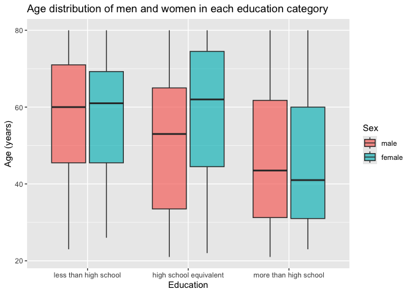
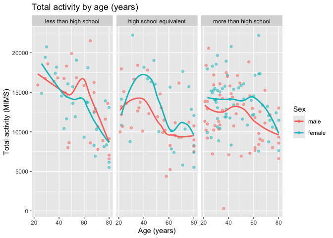
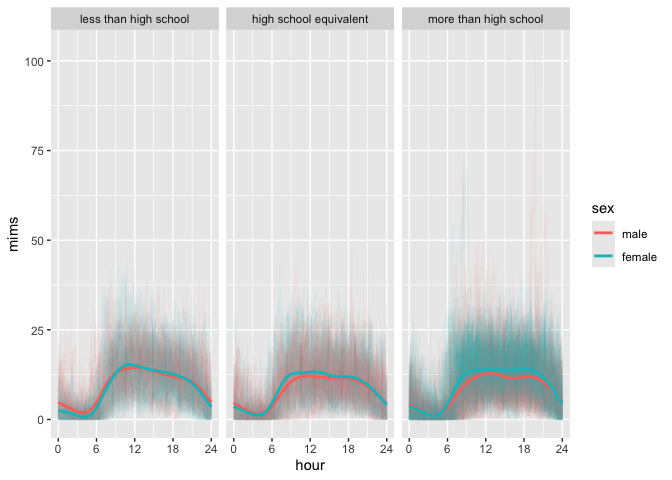
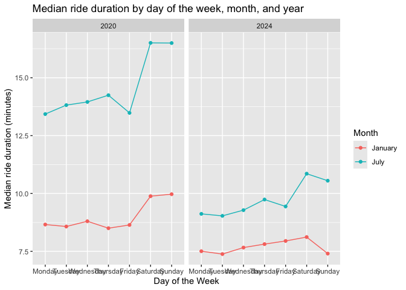
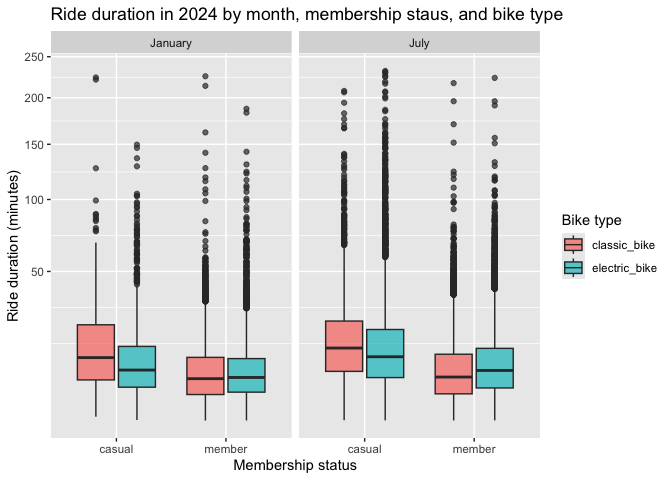

p8105_hw3_hca2124
================
Helene Apollon
2026-10-18

\#Question 1

``` r
library(hexbin)
library(patchwork)
library(ggridges)
library(tidyverse)
```

    ## ── Attaching core tidyverse packages ──────────────────────── tidyverse 2.0.0 ──
    ## ✔ dplyr     1.2.1     ✔ readr     2.2.0
    ## ✔ forcats   1.0.1     ✔ stringr   1.6.0
    ## ✔ ggplot2   4.0.3     ✔ tibble    3.3.1
    ## ✔ lubridate 1.9.5     ✔ tidyr     1.3.2
    ## ✔ purrr     1.2.2     
    ## ── Conflicts ────────────────────────────────────────── tidyverse_conflicts() ──
    ## ✖ dplyr::filter() masks stats::filter()
    ## ✖ dplyr::lag()    masks stats::lag()
    ## ℹ Use the conflicted package (<http://conflicted.r-lib.org/>) to force all conflicts to become errors

``` r
library(p8105.datasets)
data("ny_noaa")
```

The data contains daily weather records from New York weather stations.
It has 2595176 rows and 7 columns. Important variables include
precipitation (tents of mm), snowfall (mm), snow depth (mm), minimum and
maximum temperature (tents of degrees C), date of observation, and
weather station ID. The data shows a specific station at a date in time
from 1981-01-01 to 2010-12-31 across a number of 747 stations.

(missing data)

``` r
noaa_clean <- ny_noaa |>
  mutate(
    year = year(date),
    month = month(date),
    day = day(date),
    prcp = prcp / 10,                  #changing tenths of mm to mm#
    tmax = as.numeric(tmax) / 10,      #changing tenths of degree C to degree C#
    tmin = as.numeric(tmin) / 10,      #changing tenths of degree C to degree C#
  )
```

``` r
snow_fall <- noaa_clean |>
  count(snow, sort = TRUE)
```

For snowfall, the most commonly observed value is 0 mm. This is because
it does not snow often during the year such as during the summer,
spring, and fall seasons. The next most commonly observed value is NA
mm. This is because there are no data recorded for snow fall at a
particular station. The next most observed value of snowfall is non-zero
at 25 mm.

``` r
tmax_avg <- noaa_clean |>
  filter(month == 1 | month == 7) |>
  mutate(month_name = factor(month, levels = c(1,7), labels = c("January", "July"))) |>
  group_by(id, year, month_name) |>
  summarise(mean_tmax = mean(tmax, na.rm = TRUE), .groups = "drop")
```

``` r
tmax_avg |>
  ggplot(aes(x = year, y = mean_tmax, group = id)) +
  geom_line(alpha = .5) +
  geom_point(alpha = .5) +
  facet_grid(. ~ month_name) +
  labs(
    title = "Average daily maximum temperature by station in January vs July",
    x = "Year",
    y = "Mean Maximum Temperature(C) ",
    caption = "NOAA Data"
  )
```

    ## Warning: Removed 5932 rows containing missing values or values outside the scale range
    ## (`geom_line()`).

    ## Warning: Removed 5970 rows containing missing values or values outside the scale range
    ## (`geom_point()`).

<!-- -->

``` r
july_outlier <- tmax_avg |>             #outlier in July#
  filter(month_name == "July") |>
  arrange(mean_tmax) |>
  head(1)
```

``` r
january_outlier <- tmax_avg |>             #outlier in January#
  filter(month_name == "January") |>
  arrange(mean_tmax) |>
  head(1)
```

The average mean maximum temperatures are higher in July at around 25
degrees Celsius, and lower in January at around 0 degrees Celsius. This
means that the average temperatures are lower in January than in July,
which makes sense as it will be colder during the winter season of
January versus the summer season of July. In addition, the range of mean
maximum temperature values are larger in January with a range of about
-10C to 10C, while in July the range is smaller from about 20C to 30C.
As for outliers, for both months there are outliers for the coldest mean
maximum temperatures. The lowest July mean temperature was 14 degrees
Celsius in 1988. The lowest January mean temperature was -13.4 degrees
Celsius in 1982.

``` r
tmax_tmin <- noaa_clean |>
  drop_na(tmax, tmin) |>
  ggplot(aes(x = tmin, y = tmax)) +
  geom_hex(bins = 60) +
  viridis::scale_fill_viridis(option = "plasma", trans = "sqrt", name = "Count") +
  labs(
    title = "tmax vs tmin",
    x = "Minimum daily temperature (C)",
    y = "Maximum daily temperature (C)"
  )

snow_year <- noaa_clean |>
  filter(snow > 0, snow < 100) |>
  mutate(year = factor(year)) |>
  ggplot(aes(x = snow, y = year)) +
  geom_density_ridges(scale = .85) +
  labs(
    title = "Snowfall Distribution by Year",
    x = "Snowfall (mm)",
    y = "Year"
  )

tmax_tmin + snow_year
```

    ## Picking joint bandwidth of 3.76

<!-- --> \#Question 2

``` r
covar_df =
  read_csv("./nhanes_covar.csv", skip = 4) |>
  janitor::clean_names()
```

    ## Rows: 250 Columns: 5
    ## ── Column specification ────────────────────────────────────────────────────────
    ## Delimiter: ","
    ## dbl (5): SEQN, sex, age, BMI, education
    ## 
    ## ℹ Use `spec()` to retrieve the full column specification for this data.
    ## ℹ Specify the column types or set `show_col_types = FALSE` to quiet this message.

``` r
accel_df =
  read_csv("./nhanes_accel.csv") |>
  janitor::clean_names()
```

    ## Rows: 250 Columns: 1441
    ## ── Column specification ────────────────────────────────────────────────────────
    ## Delimiter: ","
    ## dbl (1441): SEQN, min1, min2, min3, min4, min5, min6, min7, min8, min9, min1...
    ## 
    ## ℹ Use `spec()` to retrieve the full column specification for this data.
    ## ℹ Specify the column types or set `show_col_types = FALSE` to quiet this message.

``` r
problem2_df =
  inner_join(covar_df, accel_df, by = "seqn") |>
  filter(age >= 21) |>
  drop_na(sex, age, bmi, education) |>
  mutate(
    sex = factor(sex, levels = c(1,2), labels = c("male", "female")),
    education = factor(education, levels = c(1,2,3),
                       labels = c("less than high school", "high school equivalent", "more than high school"))
  )
```

``` r
problem2_df |>
  count(education, sex) |>
  pivot_wider(
    names_from = sex,
    values_from = n
  ) |>
  knitr::kable()
```

| education              | male | female |
|:-----------------------|-----:|-------:|
| less than high school  |   27 |     28 |
| high school equivalent |   35 |     23 |
| more than high school  |   56 |     59 |

The dataset has a total number of 118 men and 110 women. The largest
education group is those with more than a high school level of education
with a total number of 115 men and women. Those with a high school
equivalent education had the largest gap between the number of men and
women, while the other education levels had almost an equal number of
men and women. Among those with a high school equivalent education,
there are a total number of 35 men and 23 women.

``` r
problem2_df |>
  ggplot(aes(x = education, y = age, fill = sex)) +
  geom_boxplot(alpha = .7) +
  labs(
    title = "Age distribution of men and women in each education category",
    x = "Education",
    y = "Age (years)",
    fill = "Sex"
  )
```

<!-- --> The
distribution of age for men and women that have an education level less
than high school is fairly similar, with both sexes having a mean age of
around 60 years. The distribution of age fom men and women that have an
education level more than high school is also fairly similar, with both
sexes having a mean age around 42 years. The most variation occurs in
the high school equivalent education level. Men have a lower age
distribution with a mean age of about 53 years, while women have a
higher age distribution with a mean age of about 62 years.

``` r
problem2_total_df =
  problem2_df |>
  mutate(total_activity = rowSums(across(min1:min1440)))
```

``` r
problem2_total_df |>
  ggplot(aes(x = age, y = total_activity, color = sex))+
  geom_point(alpha = .5) +
  geom_smooth(se = FALSE) +
  facet_grid(. ~ education) +
  labs(
    title = "Total activity by age (years)",
    x = "Age (years)",
    y = "Total activity (MIMS)",
    color = "Sex"
  )
```

    ## `geom_smooth()` using method = 'loess' and formula = 'y ~ x'

<!-- --> For
participants with less than high school education, women aged less than
40 had higher total activity than men, however for those aged more than
40 years, men on average had higher total activity. For participants
with a high school equivalent education, women had an average higher
total activity across all ages greater than about 25 years. There is a
large peak in total activity for women in this education level at around
40 years with a level of 17500 MMS. For those with more than high school
education, women on average had higher total activity than men across
all ages. For all education levels and sexes, total activity has an
overall decrease as age increases.

``` r
problem2_hour_df =
  problem2_df |>
  pivot_longer(
    min1:min1440,
    names_to = "minute",
    names_prefix = "min",
    values_to = "mims"
  ) |>
  mutate(
    minute = as.numeric(minute),
    hour = minute / 60
  )

problem2_mean_df =
  problem2_hour_df |>
  group_by(education, sex, hour) |>
  summarise(mean_mims = mean(mims)) |>
  ungroup()
```

    ## `summarise()` has regrouped the output.
    ## ℹ Summaries were computed grouped by education, sex, and hour.
    ## ℹ Output is grouped by education and sex.
    ## ℹ Use `summarise(.groups = "drop_last")` to silence this message.
    ## ℹ Use `summarise(.by = c(education, sex, hour))` for per-operation grouping
    ##   (`?dplyr::dplyr_by`) instead.

``` r
problem2_hour_df |>
  ggplot(aes(x = hour, y = mims, color = sex, group = seqn)) +
  geom_line(alpha = .05) +
  geom_smooth(
    data = problem2_mean_df, 
    aes(x = hour, y = mean_mims, group = sex),
    se = FALSE,
  ) +
  facet_grid(. ~ education) +
  scale_x_continuous(breaks = c(0, 6, 12, 18, 24))
```

    ## `geom_smooth()` using method = 'gam' and formula = 'y ~ s(x, bs = "cs")'

<!-- -->

``` r
  labs(
    title = "24-hour activity time courses by education and sex",
    x = "Hour",
    y = "MIMS",
    color = "Sex",
  )
```

    ## <ggplot2::labels> List of 4
    ##  $ x     : chr "Hour"
    ##  $ y     : chr "MIMS"
    ##  $ colour: chr "Sex"
    ##  $ title : chr "24-hour activity time courses by education and sex"

For both men and women in all education levels, over a 24-hour time
period, there is a similar level of mean total activity (MIMS). In
addition, both sexes and all education levels follow a similar trend in
MIMS over the course of 24 hours. Mean total activity drops close to 0
at around 6am, it peaks to about 12 MIMS at around 8am where it remains
constant before it begins to decrease at around 8pm.

\#Question 3

``` r
jan_2020_df =
  read_csv("./Jan 2020 Citi.csv.zip") |>
  janitor::clean_names() |>
  mutate(year = "2020", month = "January")
```

    ## Rows: 12420 Columns: 7
    ## ── Column specification ────────────────────────────────────────────────────────
    ## Delimiter: ","
    ## chr (6): ride_id, rideable_type, weekdays, start_station_name, end_station_n...
    ## dbl (1): duration
    ## 
    ## ℹ Use `spec()` to retrieve the full column specification for this data.
    ## ℹ Specify the column types or set `show_col_types = FALSE` to quiet this message.

``` r
jan_2024_df =
  read_csv("./Jan 2024 Citi.csv.zip") |>
  janitor::clean_names() |>
  mutate(year = "2024", month = "January")
```

    ## Rows: 18861 Columns: 7
    ## ── Column specification ────────────────────────────────────────────────────────
    ## Delimiter: ","
    ## chr (6): ride_id, rideable_type, weekdays, start_station_name, end_station_n...
    ## dbl (1): duration
    ## 
    ## ℹ Use `spec()` to retrieve the full column specification for this data.
    ## ℹ Specify the column types or set `show_col_types = FALSE` to quiet this message.

``` r
july_2020_df =
  read_csv("./July 2020 Citi.csv.zip") |>
  janitor::clean_names() |>
  mutate(year = "2020", month = "July")
```

    ## Rows: 21048 Columns: 7
    ## ── Column specification ────────────────────────────────────────────────────────
    ## Delimiter: ","
    ## chr (6): ride_id, rideable_type, weekdays, start_station_name, end_station_n...
    ## dbl (1): duration
    ## 
    ## ℹ Use `spec()` to retrieve the full column specification for this data.
    ## ℹ Specify the column types or set `show_col_types = FALSE` to quiet this message.

``` r
july_2024_df =
  read_csv("./July 2024 Citi.csv.zip") |>
  janitor::clean_names() |>
  mutate(year = "2024", month = "July")
```

    ## Rows: 47156 Columns: 7
    ## ── Column specification ────────────────────────────────────────────────────────
    ## Delimiter: ","
    ## chr (6): ride_id, rideable_type, weekdays, start_station_name, end_station_n...
    ## dbl (1): duration
    ## 
    ## ℹ Use `spec()` to retrieve the full column specification for this data.
    ## ℹ Specify the column types or set `show_col_types = FALSE` to quiet this message.

``` r
citi_df = bind_rows(jan_2020_df, jan_2024_df, july_2020_df, july_2024_df)
```

``` r
citi_df =
  citi_df |>
  mutate(
    month = factor(month, levels = c("January", "July")),
    year = factor(year),
    weekdays = factor(
      weekdays, 
      levels = c("Monday", "Tuesday", "Wednesday", "Thursday", "Friday", "Saturday", "Sunday")
    ),
    member_casual = factor(member_casual),
    rideable_type = factor(rideable_type)
  )
```

This dataset shows rides taken on NYC Citi Bikes in 2020 and 2024 of the
months January and July. It has a total of 99485 rides and 9 columns.
Key variables included ride duration (`duration`), day of the week
(`weekdays`), rider membership status (`member_casual`), and type of
bike (`rideable_type`).

``` r
citi_df |>
  count(year, month, member_casual) |>
  pivot_wider(
    names_from = member_casual,
    values_from = n
  ) |>
  knitr::kable()
```

| year | month   | casual | member |
|:-----|:--------|-------:|-------:|
| 2020 | January |    984 |  11436 |
| 2020 | July    |   5637 |  15411 |
| 2024 | January |   2108 |  16753 |
| 2024 | July    |  10894 |  36262 |

In total, there were 79862 rides from members and 19623 rides from
casual riders. The most rides occurred in July 2024 with a total of
47156 rides, with members having a larger number of rides compared to
casuals.

``` r
citi_df |>
  filter(year == "2024", month == "July") |>
  count(start_station_name, sort = TRUE) |>
  head(5) |>
  knitr::kable(
    col.names = c("Starting station", "Number of rides")
  )
```

| Starting station         | Number of rides |
|:-------------------------|----------------:|
| Pier 61 at Chelsea Piers |             163 |
| University Pl & E 14 St  |             155 |
| W 21 St & 6 Ave          |             152 |
| West St & Chambers St    |             150 |
| W 31 St & 7 Ave          |             146 |

In July of 2024, the most popular starting station was Pier 61 at
Chelsea Piers

``` r
citi_df |>
  group_by(year, month, weekdays) |>
  summarise(median_duration = median(duration, na.rm = TRUE)) |>
  ungroup() |>
  ggplot(aes(x = weekdays, y = median_duration, color = month, group = month)) +
  geom_point() +
  geom_line() +
  facet_grid(. ~ year) +
  labs(
    title = "Median ride duration by day of the week, month, and year",
    x = "Day of the Week",
    y = "Median ride duration (minutes)",
    color = "Month"
  )
```

    ## `summarise()` has regrouped the output.
    ## ℹ Summaries were computed grouped by year, month, and weekdays.
    ## ℹ Output is grouped by year and month.
    ## ℹ Use `summarise(.groups = "drop_last")` to silence this message.
    ## ℹ Use `summarise(.by = c(year, month, weekdays))` for per-operation grouping
    ##   (`?dplyr::dplyr_by`) instead.

<!-- -->

``` r
citi_df |>
  filter(year == "2024") |>
  ggplot(aes(x = member_casual, y = duration, fill = rideable_type)) +
  geom_boxplot(alpha = .7) +
  facet_grid(. ~ month) +
  scale_y_continuous(trans = "sqrt") +
  labs(
    title = "Ride duration in 2024 by month, membership staus, and bike type",
    x = "Membership status",
    y = "Ride duration (minutes)",
    fill = "Bike type"
  )
```

<!-- -->
