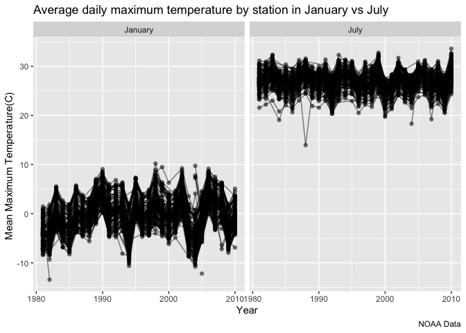
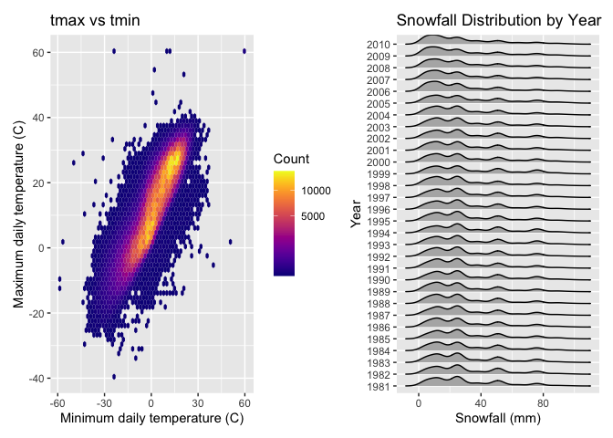

p8105_hw3_hca2124
================
Helene Apollon
2026-10-18

\#Question 1

``` r
library(hexbin)
library(patchwork)
library(ggridges)
library(tidyverse)
```

    ## ── Attaching core tidyverse packages ──────────────────────── tidyverse 2.0.0 ──
    ## ✔ dplyr     1.2.1     ✔ readr     2.2.0
    ## ✔ forcats   1.0.1     ✔ stringr   1.6.0
    ## ✔ ggplot2   4.0.3     ✔ tibble    3.3.1
    ## ✔ lubridate 1.9.5     ✔ tidyr     1.3.2
    ## ✔ purrr     1.2.2     
    ## ── Conflicts ────────────────────────────────────────── tidyverse_conflicts() ──
    ## ✖ dplyr::filter() masks stats::filter()
    ## ✖ dplyr::lag()    masks stats::lag()
    ## ℹ Use the conflicted package (<http://conflicted.r-lib.org/>) to force all conflicts to become errors

``` r
library(p8105.datasets)
data("ny_noaa")
```

The data contains daily weather records from New York weather stations.
It has 2595176 rows and 7 columns. Important variables include
precipitation (tents of mm), snowfall (mm), snow depth (mm), minimum and
maximum temperature (tents of degrees C), date of observation, and
weather station ID. The data shows a specific station at a date in time
from 1981-01-01 to 2010-12-31 across a number of 747 stations.

(missing data)

``` r
noaa_clean <- ny_noaa |>
  mutate(
    year = year(date),
    month = month(date),
    day = day(date),
    prcp = prcp / 10,                  #changing tenths of mm to mm#
    tmax = as.numeric(tmax) / 10,      #changing tenths of degree C to degree C#
    tmin = as.numeric(tmin) / 10,      #changing tenths of degree C to degree C#
  )
```

``` r
snow_fall <- noaa_clean |>
  count(snow, sort = TRUE)
```

For snowfall, the most commonly observed value is 0 mm. This is because
it does not snow often during the year such as during the summer,
spring, and fall seasons. The next most commonly observed value is NA
mm. This is because there are no data recorded for snow fall at a
particular station. The next most observed value of snowfall is non-zero
at 25 mm.

``` r
tmax_avg <- noaa_clean |>
  filter(month == 1 | month == 7) |>
  mutate(month_name = factor(month, levels = c(1,7), labels = c("January", "July"))) |>
  group_by(id, year, month_name) |>
  summarise(mean_tmax = mean(tmax, na.rm = TRUE), .groups = "drop")
```

``` r
tmax_avg |>
  ggplot(aes(x = year, y = mean_tmax, group = id)) +
  geom_line(alpha = .5) +
  geom_point(alpha = .5) +
  facet_grid(. ~ month_name) +
  labs(
    title = "Average daily maximum temperature by station in January vs July",
    x = "Year",
    y = "Mean Maximum Temperature(C) ",
    caption = "NOAA Data"
  )
```

    ## Warning: Removed 5932 rows containing missing values or values outside the scale range
    ## (`geom_line()`).

    ## Warning: Removed 5970 rows containing missing values or values outside the scale range
    ## (`geom_point()`).

<!-- -->

``` r
july_outlier <- tmax_avg |>             #outlier in July#
  filter(month_name == "July") |>
  arrange(mean_tmax) |>
  head(1)
```

``` r
january_outlier <- tmax_avg |>             #outlier in January#
  filter(month_name == "January") |>
  arrange(mean_tmax) |>
  head(1)
```

The average mean maximum temperatures are higher in July at around 25
degrees Celsius, and lower in January at around 0 degrees Celsius. This
means that the average temperatures are lower in January than in July,
which makes sense as it will be colder during the winter season of
January versus the summer season of July. In addition, the range of mean
maximum temperature values are larger in January with a range of about
-10C to 10C, while in July the range is smaller from about 20C to 30C.
As for outliers, for both months there are outliers for the coldest mean
maximum temperatures. The lowest July mean temperature was 14 degrees
Celsius in 1988. The lowest January mean temperature was -13.4 degrees
Celsius in 1982.

``` r
tmax_tmin <- noaa_clean |>
  drop_na(tmax, tmin) |>
  ggplot(aes(x = tmin, y = tmax)) +
  geom_hex(bins = 60) +
  viridis::scale_fill_viridis(option = "plasma", trans = "sqrt", name = "Count") +
  labs(
    title = "tmax vs tmin",
    x = "Minimum daily temperature (C)",
    y = "Maximum daily temperature (C)"
  )

snow_year <- noaa_clean |>
  filter(snow > 0, snow < 100) |>
  mutate(year = factor(year)) |>
  ggplot(aes(x = snow, y = year)) +
  geom_density_ridges(scale = .85) +
  labs(
    title = "Snowfall Distribution by Year",
    x = "Snowfall (mm)",
    y = "Year"
  )

tmax_tmin + snow_year
```

    ## Picking joint bandwidth of 3.76

<!-- --> \#Question 2

``` r
covar_df =
  read_csv("./nhanes_covar.csv", skip = 4) |>
  janitor::clean_names()
```

    ## Rows: 250 Columns: 5
    ## ── Column specification ────────────────────────────────────────────────────────
    ## Delimiter: ","
    ## dbl (5): SEQN, sex, age, BMI, education
    ## 
    ## ℹ Use `spec()` to retrieve the full column specification for this data.
    ## ℹ Specify the column types or set `show_col_types = FALSE` to quiet this message.

``` r
accel_df =
  read_csv("./nhanes_accel.csv") |>
  janitor::clean_names()
```

    ## Rows: 250 Columns: 1441
    ## ── Column specification ────────────────────────────────────────────────────────
    ## Delimiter: ","
    ## dbl (1441): SEQN, min1, min2, min3, min4, min5, min6, min7, min8, min9, min1...
    ## 
    ## ℹ Use `spec()` to retrieve the full column specification for this data.
    ## ℹ Specify the column types or set `show_col_types = FALSE` to quiet this message.

``` r
problem2_df =
  inner_join(covar_df, accel_df, by = "seqn") |>
  filter(age >= 21) |>
  drop_na(sex, age, bmi, education) |>
  mutate(
    sex = factor(sex, levels = c(1,2), labels = c("male", "female")),
    education = factor(education, levels = c(1,2,3),
                       labels = c("less than high school", "high school equivalent", "more than high school"))
  )
```

``` r
problem2_df |>
  count(education, sex) |>
  pivot_wider(
    names_from = sex,
    values_from = n
  ) |>
  knitr::kable()
```

| education              | male | female |
|:-----------------------|-----:|-------:|
| less than high school  |   27 |     28 |
| high school equivalent |   35 |     23 |
| more than high school  |   56 |     59 |

The dataset has a total number of 118 men and 110 women. The largest
education group is those with more than a high school level of education
with a total number of 115 men and women. Those with a high school
equivalent education had the largest gap between the number of men and
women, while the other education levels had almost an equal number of
men and women. Among those with a high school equivalent education,
there are a total number of 35 men and 23 women.
